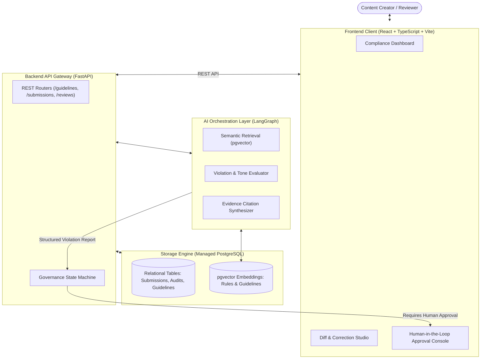

# BrandShield AI — Intelligent Brand-Governance Platform

> **CodeNova India 2026 Round 2 Project**  
> *An agentic, evidence-backed brand compliance platform with inviolable human-in-the-loop governance.*

---

## 1. Project Overview & Purpose

**BrandShield AI** is an enterprise-grade brand governance platform designed to ensure that marketing copy, social media announcements, advertisements, customer communications, and technical documentation adhere strictly to official brand standards, tone directives, messaging rules, and verified facts.

In large organizations and fast-paced marketing teams, content is published across numerous channels. Fragmented guidelines and manual editorial review often lead to:
- Inconsistent tone and voice across channels.
- Inaccurate product claims and factual errors.
- Unapproved terminology and prohibited competitor comparisons.
- High review latency and editorial bottlenecks.

BrandShield AI solves this by combining **hybrid semantic retrieval (`pgvector`)**, **deterministic rule checks**, and **LangGraph agentic orchestration** to rapidly audit submitted content, identify violations, quote verifiable evidence, and synthesize actionable corrections — while maintaining an unbreakable architectural rule:

> **Core Governance Invariant**:  
> The AI agent evaluates, flags violations, and suggests corrections, but **never makes final approval decisions**. Final publishing authorization requires explicit human review and sign-off.

---

## 2. Core Product Workflow

BrandShield AI guides content through a 7-stage governance pipeline:

```text
1. Brand Guidelines Ingestion
   └── Upload & index brand guidelines, approved facts, forbidden terminology, tone rules.

2. Content Submission
   └── Authors submit copy (social posts, ads, emails, press releases) with channel metadata.

3. Hybrid AI Compliance Check
   └── Vector similarity search (pgvector) + deterministic regex/keyword rule checking.

4. Violation Identification & Citation
   └── Highlighting exact text spans, severity scoring, and citing source guideline clauses.

5. Evidence-Backed Correction Studio
   └── Context-aware alternatives with side-by-side diffs adhering strictly to guidelines.

6. Human-in-the-Loop Review
   └── Human reviewer reviews, edits, approves, rejects, or requests author revision.

7. Versioning & Audit Trail
   └── Immutable history tracking every iteration, AI analysis report, and human decision.
```

---

## 3. Technology Stack

### Frontend
- **Framework**: React 19 / 18 with TypeScript
- **Build Tool**: Vite
- **Styling**: Tailwind CSS
- **Component Architecture**: Modular, accessible, responsive UI with dedicated review consoles

### Backend
- **Runtime**: Python (3.14 compatible, verified FastAPI 0.141.1, Pydantic 2.13.4, Uvicorn 0.52.3)
- **API Framework**: FastAPI (asynchronous ASGI framework)
- **Data Validation**: Pydantic v2
- **Testing**: pytest, pytest-asyncio, httpx

### Database & Vector Storage
- **Database**: Managed PostgreSQL
- **Vector Indexing**: `pgvector` extension for high-performance cosine/inner-product similarity search

### AI & Agentic Orchestration
- **Agent Orchestrator**: LangGraph (stateful graph with human-in-the-loop transition gates)
- **Provider Abstraction**: Decoupled LLM and Embedding provider interface (supporting Gemini, OpenAI, Anthropic, or local endpoints)
- **Structured Outputs**: Strict Pydantic-enforced JSON validation for violation schemas

---

## 4. Planned Architecture



---

## 5. Project Folder Structure

The project is structured as a clean, modular monorepo:

```text
BrandShield-AI/
├── frontend/                     # React + TypeScript + Vite + Tailwind CSS client
│   ├── src/                      # Source code (components, pages, services, types)
│   ├── public/                   # Static public assets
│   ├── package.json              # Frontend package definitions
│   ├── vite.config.ts            # Vite configuration
│   └── README.md                 # Frontend architecture and setup notes
│
├── backend/                      # FastAPI + Python backend engine
│   ├── app/                      # Application code (api, core, models, schemas, ai)
│   ├── tests/                    # Automated test suites
│   ├── requirements.txt          # Python dependencies
│   └── README.md                 # Backend architecture and setup notes
│
├── docs/                         # In-depth architectural & project documentation
│   ├── architecture.md           # System architecture and technical specifications
│   ├── development-phases.md     # Phase-by-phase roadmap and milestones
│   └── submission-spec.md        # Submission archive specification & verification checklist
│
├── .gitignore                    # Root gitignore (node_modules, .venv, secrets, archives)
└── README.md                     # Root project documentation
```

---

## 6. Implementation Status & Feature Matrix

To maintain rigorous transparency, features are categorized into implemented vs planned:

| Module / Feature | Status | Notes |
| :--- | :--- | :--- |
| **Project Repository & Boundary Isolation** | **Implemented (Phase 1)** | Dedicated git repository initialized inside project directory. |
| **Comprehensive Gitignore & Secret Shielding** | **Implemented (Phase 1)** | Excludes node_modules, .venv, .env, build outputs, and archives. |
| **Architecture & Phase Specifications** | **Implemented (Phase 1)** | Detailed in `docs/` and root documentation. |
| **Submission ZIP Specification** | **Implemented (Phase 1)** | Criteria and pre-delivery verification gates documented. |
| **Backend API & Data Schemas** | *Planned (Phase 2)* | FastAPI endpoints, Pydantic v2 schemas, and test harnesses. |
| **Managed PostgreSQL + pgvector Setup** | *Planned (Phase 2)* | Schema migrations, relational tables, vector indexing. |
| **LangGraph Agentic Orchestrator** | *Planned (Phase 3)* | Retrieval, violation detection, citation, and correction graph. |
| **Evidence & Citation Engine** | *Planned (Phase 3)* | Linking all flagged issues directly to official brand clauses. |
| **Frontend React Client Scaffolding** | *Planned (Phase 4)* | Vite + Tailwind CSS UI for content review and diffing. |
| **Human-in-the-Loop Governance Console** | *Planned (Phase 4)* | Human approval, rejection, editing, and revision workflow. |
| **End-to-End Testing & Submission Packaging** | *Planned (Phase 5)* | Full automated test suite and `BrandShield-AI-Submission.zip`. |

---

## 7. Development Roadmap

- **Phase 1: Project Initialization & Architecture** — *Current Phase (Completed)*
- **Phase 2: Core Data Models, Database Integration & API Foundation** — *Next Phase*
- **Phase 3: AI Engine, LangGraph Orchestration & Verification Workflow**
- **Phase 4: Frontend Development & Human-in-the-Loop Review UI**
- **Phase 5: Automated Testing, Security Auditing & Submission Packaging**

---

## 8. Setup & Execution Instructions

*(These instructions will expand incrementally as implementation progresses through each phase).*

### Prerequisites
- **Node.js**: v20+ (Verified: v24.19.0)
- **npm**: v10+ (Verified: 11.17.0)
- **Python**: 3.12+ / 3.14 (Verified: Python 3.14.6 with pip 26.2.2)
- **Git**: 2.40+ (Verified: 2.55.0.windows.4)

### Clone & Repository Boundary
```bash
# Verify you are in the isolated BrandShield AI repository
cd "BrandShield AI"
git status
```

### Backend Setup (Phase 2 Onward)
```bash
# Navigate to backend directory
cd backend

# Create isolated virtual environment
python -m venv .venv

# Activate virtual environment (Windows PowerShell)
.venv\Scripts\Activate.ps1

# Install dependencies
pip install -r requirements.txt

# Run backend API server
uvicorn app.main:app --reload --port 8000
```

### Frontend Setup (Phase 4 Onward)
```bash
# Navigate to frontend directory
cd frontend

# Install dependencies
npm install

# Start Vite development server
npm run dev
```

---

## 9. Submission ZIP Packaging Requirement

Per CodeNova India 2026 requirements, a submission-ready archive will be produced at the conclusion of Phase 5:
- **Archive Name**: `BrandShield-AI-Submission.zip`
- **Location**: `submission/` directory
- **Status in Phase 1**: **NOT GENERATED**. The archive will only be created after all development, tests, and security verifications are completed in Phase 5.
- Refer to `docs/submission-spec.md` for the full pre-delivery verification checklist.
