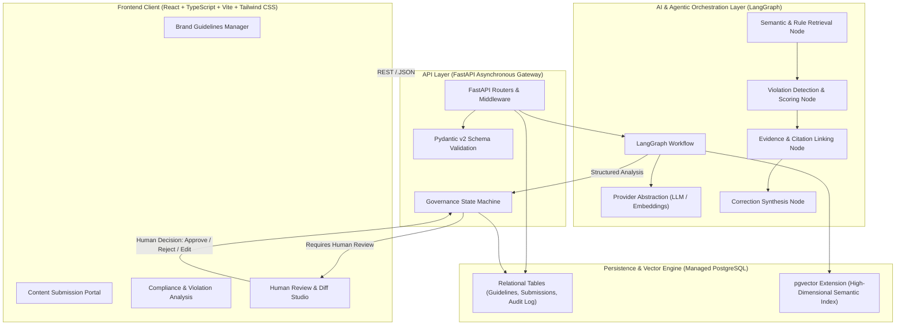

# BrandShield AI — System Architecture Specification

## 1. System Overview & Problem Statement

**BrandShield AI** is an intelligent brand-governance and content compliance platform engineered for **CodeNova India 2026 Round 2**.

Modern enterprises and decentralized marketing teams produce vast quantities of content across social media, advertising campaigns, investor decks, and customer communications. Maintaining brand consistency, regulatory compliance, factual accuracy, and approved terminology across these channels is manual, prone to human error, and slow.

BrandShield AI automates the brand compliance audit process while keeping humans firmly in control:
- Ingests and structures brand guidelines, approved facts, forbidden terms, tone directives, and visual/textual asset standards.
- Evaluates submitted drafts against indexed guidelines using hybrid retrieval (vector similarity + rule-based matching).
- Identifies exact rule breaches, scores violation severity, and extracts direct evidentiary quotes.
- Synthesizes actionable, evidence-backed correction suggestions.
- Coordinates a human-in-the-loop review workflow where human reviewers authorize approvals, edits, rejections, or revision requests.
- **Inviolable Architectural Invariant**: The AI agent assists and evaluates, but **never** performs final approvals without explicit human authorization.

---

## 2. High-Level Architecture Diagram



---

## 3. Core Product Workflow

BrandShield AI executes an end-to-end 7-stage governance lifecycle:

```text
  [1. Ingest Brand Assets]
            │
            ▼
  [2. Submit Draft Content] ─── (Social, Ads, Emails, Documents)
            │
            ▼
  [3. Hybrid Compliance Check] ── (pgvector semantic retrieval + deterministic rules)
            │
            ▼
  [4. Violation Identification] ── (Severity rating + exact rule citation)
            │
            ▼
  [5. Evidence-Backed Corrections] ── (Side-by-side diffs + source quotes)
            │
            ▼
  [6. Human Review & Decision] ── (Human approves, rejects, edits, or requests revision)
            │
            ▼
  [7. Versioning & Audit Trail] ── (Immutable log of all reviews and status changes)
```

### Detailed Lifecycle Stages:
1. **Brand Knowledge Ingestion**:
   - Brand guidelines, terminology rules, messaging pillars, and approved facts are parsed, chunked, and embedded.
   - Vector embeddings are indexed into PostgreSQL via the `pgvector` extension.
   - Exact negative rules (e.g., forbidden claims, competitor mentions, disallowed jargon) are indexed into deterministic rule tables.
2. **Content Submission**:
   - Content authors submit copy through the frontend interface or API, specifying the target channel (e.g., LinkedIn, X/Twitter, Email, Press Release) and target audience.
   - The submission enters the `UNDER_ANALYSIS` state.
3. **Hybrid AI Verification**:
   - The LangGraph orchestration engine queries `pgvector` for guidelines relevant to the submission context.
   - Deterministic rule filters execute keyword and regex checks for forbidden claims.
   - LLM reasoning checks tone alignment, factual accuracy against approved facts, and adherence to messaging pillars.
4. **Violation Identification & Citation**:
   - Every detected issue is cataloged with:
     - `rule_id` and `rule_name`
     - `severity` (`LOW`, `MEDIUM`, `HIGH`, `CRITICAL`)
     - `violating_text` (exact span in submitted content)
     - `guideline_quote` (evidence extracted from official brand documentation)
     - `explanation` (concise rationale for why the text violates the policy)
5. **Evidence-Backed Suggestion Engine**:
   - The agent constructs alternative phrasings that eliminate the violation while maintaining the author's intent.
   - Corrections are verified to strictly adhere to indexed guidelines.
6. **Human-in-the-Loop Review**:
   - The human reviewer inspects the violation report, interactive diff, and cited evidence.
   - The reviewer selects an explicit action:
     - **Approve**: Only executable by a human reviewer.
     - **Reject**: Marks submission as unacceptable with required reasoning.
     - **Request Revision**: Sends submission back to author with actionable feedback.
     - **Direct Edit & Approve**: Reviewer modifies text directly and commits the approved version.
7. **Version History & Audit Logging**:
   - Every transition, edit, and decision is recorded in an immutable audit ledger with timestamps and user identifiers.

---

## 4. Key Architectural Decisions

| Decision | Selection | Justification |
| :--- | :--- | :--- |
| **Frontend Framework** | React + TypeScript + Vite | Industry-standard rapid development, high developer productivity, type safety, and optimized build pipelines. |
| **Styling** | Tailwind CSS | Rapid utility-first styling ensuring clean, responsive SaaS UI without style fragmentation. |
| **Backend Framework** | FastAPI (Python) | High-performance asynchronous REST API, native Pydantic v2 validation, automated OpenAPI docs, and clean ecosystem integration with AI tools. |
| **Database & Vector Store** | Managed PostgreSQL + `pgvector` | Eliminates the need for separate vector databases; combines ACID relational data (users, guidelines, reviews) and vector similarity search in a single reliable engine. |
| **Agent Orchestration** | LangGraph | Stateful, graph-based agent orchestration enabling cyclic verification loops, deterministic state transitions, and robust human-in-the-loop gates. |
| **AI Provider Abstraction** | Pluggable Provider Interface | Decouples business logic from specific LLM vendors (OpenAI, Gemini, Anthropic, local models), preventing vendor lock-in. |

---

## 5. Security & Boundary Principles

1. **Zero Secret Leakage**:
   - API keys, database credentials, and service tokens must never be committed to git or exposed to the frontend client.
   - All external API calls and database connections are strictly backend-mediated.
2. **Strict Repository Boundary**:
   - The BrandShield AI repository is completely isolated from parent directories.
   - Git operations are strictly confined within the project root.
3. **Environment Segregation**:
   - Configuration is managed via Pydantic `BaseSettings` reading from `.env` files (excluded from version control). An `.env.example` template provides transparent setup instructions without sensitive data.
4. **Data Isolation**:
   - Brand guidelines and submission data are logically segregated per organization/workspace to prevent cross-tenant contamination.
