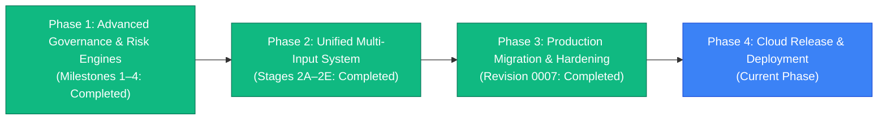

# BrandShield AI — Development Phases & Implementation Roadmap

**Event:** CodeNova India Round 3  
**Target Product:** BrandShield AI — Intelligent Multimodal Brand-Governance Platform  
**Current Status:** All Phase 1 Milestones (1–4) and Phase 2 Stages (2A–2E) Completed and Verified

---

## Roadmap Overview & Completion Scorecard

---

## Phase 1: Advanced Governance & Risk Assessment Engine (COMPLETED)

Phase 1 established the intelligent compliance evaluation, risk modeling, and claim-checking foundations of BrandShield AI across four major milestones.

### Milestone 1: Multi-Factor Risk Assessment Engine
- [x] Implemented multi-factor risk scoring engine in `backend/app/engine/risk_scorer.py`.
- [x] Designed normalized overall risk score scale (0.0 to 100.0) mapping to severity tiers: `LOW` (0–24), `MEDIUM` (25–49), `HIGH` (50–74), `CRITICAL` (75–100).
- [x] Incorporated channel-specific multiplier matrices (e.g., higher multipliers for external broadcast media vs lower multipliers for internal documentation).
- [x] Incorporated target audience sensitivity weighting.
- [x] Updated `compliance_reports` schema with risk columns (`risk_score`, `risk_level`, `is_escalated`, `channel_multiplier`, `audience_multiplier`, `risk_breakdown`).
- [x] Added database-level `CHECK` constraints on score ranges, risk levels, and positive multipliers.
- [x] Automated test coverage: unit tests in `test_risk_scorer.py` and regression integration tests.

### Milestone 2: Intelligent Rule Ingestion & Auto-Drafting Engine
- [x] Built document extractor and rule parser in `backend/app/engine/guideline_extractor.py` supporting PDF and DOCX files.
- [x] Created candidate guidelines staging pipeline in `backend/app/api/v1/candidate_guidelines.py` and `candidate_guideline_svc.py`.
- [x] Enforced strict candidate quarantine: candidate guidelines remain pending or rejected and are never used as active compliance criteria until an Admin explicitly approves them.
- [x] Built immutable append-only audit ledger (`candidate_guideline_audits`) tracking all drafting, editing, and approval actions with database triggers preventing `UPDATE` and `DELETE`.
- [x] Created Admin review endpoints: `POST /api/v1/candidate-guidelines/ingest-document`, `GET /api/v1/candidate-guidelines`, `POST /api/v1/candidate-guidelines/{id}/review`.
- [x] Automated test coverage: dedicated suites in `test_guideline_extractor.py` and `test_candidate_guidelines.py`.

### Milestone 3: Dynamic Adaptive Rules Engine
- [x] Implemented dynamic rule filtering and contextual evaluation in `backend/app/engine/evaluator.py`.
- [x] Rules dynamically adapt their activation based on content channel (social, email, print, press release) and target audience (general public, enterprise, internal).
- [x] Prevented false positives by suppressing format-specific rules (e.g., character count limits or hashtag requirements) on incompatible content types.
- [x] Verified contextual scoring consistency across all rule types (trademark usage, prohibited claims, tone of voice, formatting, legal/regulatory).

### Milestone 4: Claim Verification & Fact-Checking Engine
- [x] Implemented dedicated claim extraction and verification engine in `backend/app/engine/claim_verifier.py`.
- [x] Created `claim_verifications` table in Alembic migration 0007 with forced Row-Level Security (`FORCE ROW LEVEL SECURITY`).
- [x] Standardized rigorous claim status classifications: `VERIFIED`, `UNSUPPORTED`, `OUTDATED`, `CONTRADICTORY`, and `NEEDS_HUMAN_REVIEW`.
- [x] Enforced empirical evidence provenance: every verified claim quotes the source guideline title, specific excerpt, and confidence score.
- [x] Implemented strict classification guards: claims are marked `OUTDATED` only when both the superseded record and newer approved record exist; simple n-gram overlap is rejected as proof of verification.
- [x] Enforced honest fallback behavior: if external AI is unconfigured or rate-limited, claims fall back to `NEEDS_HUMAN_REVIEW` with transparent uncertainty notes.
- [x] Automated test coverage: verified in `test_claim_verifier.py` and `test_claim_verifications_db.py`.

---

## Phase 2: Unified Multi-Input System & Multimodal Governance (COMPLETED)

Phase 2 expanded BrandShield AI from text-only analysis into a comprehensive multimodal governance platform handling five input formats.

### Stage 2A: Multimodal Preprocessing Service
- [x] Created `backend/app/engine/multimodal/service.py` to coordinate preprocessing across all media types.
- [x] Built strict MIME-type validator and magic-byte sniffer (`validator.py`) to prevent file extension spoofing.
- [x] Built ephemeral temporary file manager (`temp_manager.py`) enforcing chunked streaming, safe file creation in `/tmp/brandshield_uploads`, and guaranteed unlinking in `finally` blocks.
- [x] Implemented multi-format document parser (`extractor.py`) using `pypdf` for PDFs and native XML parsing for Word documents (`word/document.xml`).
- [x] Automated test coverage: 40+ multimodal preprocessing tests in `test_multimodal_service.py` and `test_multimodal_ingestion.py`.

### Stage 2B: Backend Upload API & Compliance Pipeline Integration
- [x] Implemented multipart submission endpoint `POST /api/v1/submissions/upload` accepting media files, accompanying text, title, channel, and audience.
- [x] Preserved legacy JSON submission endpoint `POST /api/v1/submissions` without breaking backward compatibility.
- [x] Integrated multimodal observations into the LangGraph state machine (`graph.py`) and compliance evaluator (`evaluator.py`).
- [x] Stored media metadata, dimensions, page counts, durations, and observation summaries in `content_submissions.media_metadata`.
- [x] Automated test coverage: verified in `test_multimodal_submissions.py`.

### Stage 2C: Visual Brand Compliance Engine
- [x] Implemented visual rule evaluation layer in `backend/app/engine/rules/visual.py`.
- [x] Built brand logo presence, placement, and clear-space inspection.
- [x] Built brand color palette comparator checking extracted color signatures against approved hex codes.
- [x] Extracted OCR on-screen text and verified it against prohibited claims and trademark directives.
- [x] Emitted normalized visual bounding boxes (`[ymin, xmin, ymax, xmax]`) and video timestamp markers for flagged violations.
- [x] Automated test coverage: verified in `test_visual_compliance_engine.py`.

### Stage 2D: Unified Multi-Input Workspace & Frontend Implementation
- [x] Built responsive five-modality submission workspace in `frontend/src/pages/SubmissionPage.tsx`.
- [x] Added mobile-first camera capture input utilizing native HTML5 `capture="environment"` and `accept="image/*"`.
- [x] Added audio recording and video upload interfaces with interactive media previews.
- [x] Implemented client-side 10MB file size ceiling guard, zero-byte protection, and object URL memory leak prevention (`revokeObjectURL`).
- [x] Created `MediaBadge.tsx` component with distinct color-coded badges for Text, Image, Audio, Video, and Document assets.
- [x] Enhanced `AnalysisResultsPage.tsx` with bounding box visual overlays, video timestamp markers, and claim verification status badges.
- [x] Automated test coverage: 12 workspace invariant tests in `multimodalWorkspace.test.ts`.

### Stage 2E: Comprehensive End-to-End Multimodal Integration Testing
- [x] Executed full-system integration tests across all five modalities in `test_multimodal_e2e_integration.py`.
- [x] Verified end-to-end user workflows: submission, multimodal extraction, risk assessment, claim verification, human review, and immutable audit logging.
- [x] Verified zero permanent disk retention and complete cleanup of temporary upload directories.
- [x] Confirmed 100% test pass rate across both backend (340 tests) and frontend (70 tests).

---

## Phase 3: Production Database Migration & Schema Alignment (COMPLETED)

- [x] Authored Alembic Migration `0007_add_risk_assessment_and_claim_verification.py`.
- [x] Conducted comprehensive read-only migration safety audit against production Neon PostgreSQL.
- [x] Verified dual-role separation: `neondb_owner` (DDL migration owner) vs `brandshield_app` (least-privilege runtime DML).
- [x] Applied Migration 0007 successfully to the production Neon PostgreSQL database:
  - Table `claim_verifications` created with primary key, foreign keys, indexes, and check constraints.
  - Added 6 risk assessment columns to `compliance_reports` with non-negative constraints.
  - Enabled and forced PostgreSQL Row-Level Security (`FORCE ROW LEVEL SECURITY`).
  - Attached cross-tenant integrity trigger `trg_claim_verification_org_match`.
  - Granted `SELECT, INSERT, DELETE` on `claim_verifications` to `brandshield_app` (with `UPDATE` denied).
  - Verified 100% data integrity with zero data loss across existing compliance reports and audit entries.

---

## Phase 4: Production Release & Cloud Deployment (CURRENT PHASE)

### Current Live Deployment Status
- **Frontend SPA (Vercel):** [https://brandshield-ai-original.vercel.app/](https://brandshield-ai-original.vercel.app/)  
  *(Currently serving baseline production build; pending rebuild with completed Round 3 workspace)*
- **Backend API (Render):** [https://brandshield-ai-64k9.onrender.com](https://brandshield-ai-64k9.onrender.com)  
  *(Operational on Render Free Tier with HTTP 200 on `/health`; pending redeployment with 41 routes)*
- **Database (Neon Serverless):** `ep-dry-term-aork65r1...neon.tech/neondb`  
  *(Fully migrated to Alembic revision 0007; synchronized with completed codebase)*

### Recommended Deployment Execution Sequence
1. **Repository Synchronization:** Stage, commit, and push all Phase 1 and Phase 2 source files and tests to `origin/main`.
2. **Backend Redeployment:** Trigger deployment on Render Web Service to serve all 41 routes (including `POST /api/v1/submissions/upload` and `candidate-guidelines`).
3. **Frontend Redeployment:** Ensure `VITE_API_BASE_URL=https://brandshield-ai-64k9.onrender.com` is configured in Vercel project environment settings, and trigger a fresh production build.
4. **Smoke Verification:** Access the live Vercel application, log in with demo credentials, submit an image or document, and verify risk score and claim verification outputs.
5. **Final Submission Packaging:** Produce the submission archive `BrandShield-AI-Submission.zip` per `docs/submission-spec.md`.
